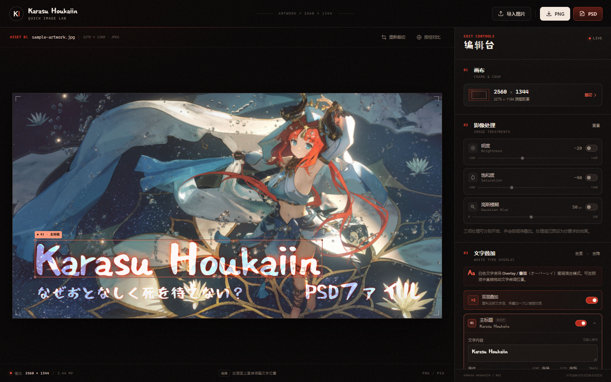
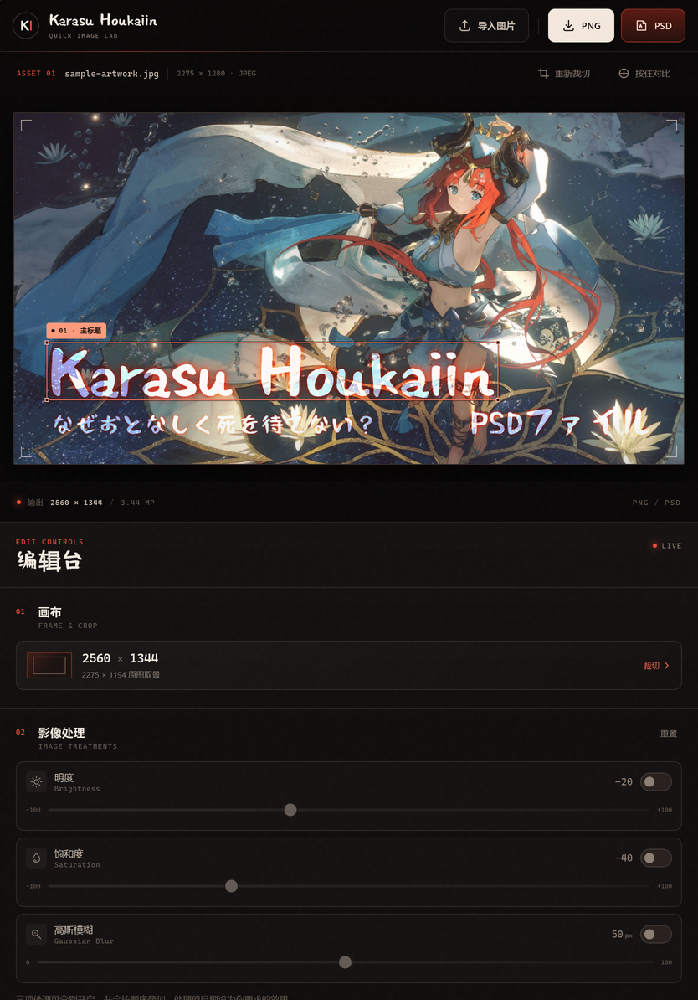
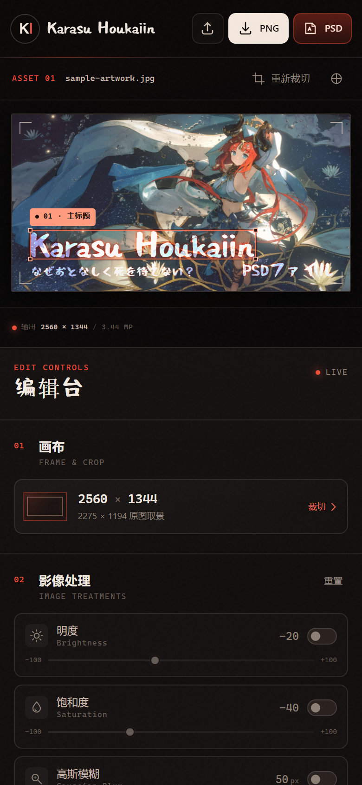
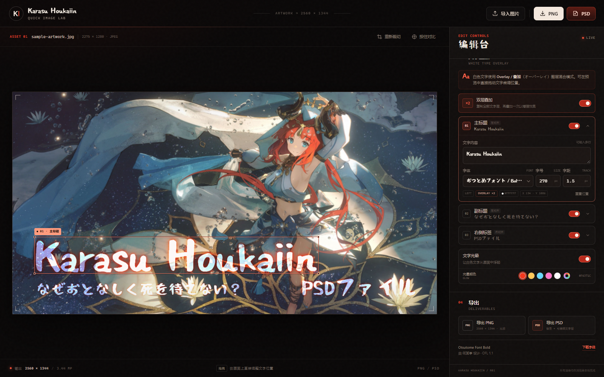

# Karasu Houkaiin · Quick Image Lab

一个纯前端、浏览器本地运行的快速图片编辑器，用于生成 **2560 × 1344 px** 的图片，并导出 **PNG** 与 **PSD**。

**在线使用：** <https://antilovsky.github.io/Karasu-houkaiin-Fanbox-cover-image-maker/>

> 如果打开后不是本编辑器，请核对地址是否为上面的完整项目路径（注意仓库名大小写与末尾斜杠），并强制刷新一次浏览器缓存。



<p align="center">
  
  
</p>

## 快速启动

1. 双击 `启动编辑器.bat`。
2. 浏览器会自动打开 `http://127.0.0.1:8765/`。
3. 关闭黑窗即可停止本地服务。

也可以在当前目录手动运行：

```bash
python -m http.server 8765 --bind 127.0.0.1
```

然后访问 <http://127.0.0.1:8765/>。

> 请通过本地服务器访问，不要直接双击 `index.html`。浏览器对 `file://` 下的图片与 Canvas 有安全限制，会导致 PNG / PSD 导出失败。

## 在线访问：托管到 GitHub Pages

本仓库是纯静态站点，不需要构建，推荐用 **Deploy from a branch** 方式发布：

1. 打开仓库的 **[Settings → Pages](https://github.com/antilovsky/Karasu-houkaiin-Fanbox-cover-image-maker/settings/pages)**。
2. 在 **Build and deployment → Source** 中选择 **Deploy from a branch**。
3. **Branch** 选择 `main`，目录选择 `/ (root)`，点击 **Save**。
4. 等待约 1–2 分钟。Pages 页面会显示站点地址，通常为：
   <https://antilovsky.github.io/Karasu-houkaiin-Fanbox-cover-image-maker/>
5. 打开该地址即可在线使用。之后每次推送到 `main`，站点会自动重新发布。

仓库中包含 `.nojekyll`，GitHub Pages 会按原始静态文件发布，不经过 Jekyll 处理；字体、图片、`vendor/ag-psd.js` 和下载字体链接都可以通过 GitHub Pages 的子路径正常加载。

如果首次打开返回 404，请等待 Pages 部署完成；仍无法访问时，可在 **Actions** 中查看失败原因。已部署后更新页面时，GitHub Pages 通常需要 1–3 分钟同步；样式与脚本带有版本参数，刷新即可获取新版本。

## 功能

### 画布与裁切

- 固定输出 **2560 × 1344 px**（约 3.44 MP）。
- 导入 JPG / PNG / WEBP / GIF / AVIF。
- 图片比例不是 2560 : 1344 时，自动打开裁切视图。
- 在 1.9048 的锁定比例画框内自由缩放、拖动，任何局部都可以成为画面。
- 已导入的图片也可以随时点「重新裁切」更换取景。

### 影像处理（可独立开启 / 关闭）

| 处理 | 预设值 | 可调范围 |
| --- | --- | --- |
| 明度 Brightness | −20 | −100 ~ +100 |
| 饱和度 Saturation | −40 | −100 ~ +100 |
| 高斯模糊 Gaussian Blur | 50 px | 0 ~ 100 px |

三项可以叠加使用，处理结果显示在预览、PNG 和 PSD 中。

### 白色文字 Overlay 叠加

- 三组独立文字图层：
  - 左下 · 主标题 `Karasu Houkaiin`（左对齐，默认 270 px）
  - 左下 · 副标题 `なぜおとなしく死を待てない？`（左对齐）
  - 右下 · 右侧标签 `PSDファイル`（右对齐）
- 文字层使用 **Overlay（叠加 / オーバーレイ）图层混合模式**，而不是普通上下叠放；画面和导出的 PSD 文字层都保留该混合模式。
- **双层叠加**选项默认开启：每个文字图层会复制一份并再次以 Overlay 合成，使亮部更亮、颜色更浓；可一键切回单层。
- 默认字体：**Otsutome Font Bold**（おつとめフォント，OFL 1.1），字体文件已随项目本地提供。
- 每个图层都可以独立显示 / 隐藏。
- 可以修改文字内容、字体、字号、字距，并直接在画面上拖动位置。
- 可以上传自己的 TTF / OTF / WOFF / WOFF2 字体。
- 白色文字带可关闭的文字光晕；光晕颜色可选红色、金色、冰蓝、粉色、白色，也可以通过原生取色器自定义任意颜色。
- 选中文字后，用方向键微调 1 px；按住 `Shift` 每次 10 px。

<p align="center">
  
</p>

### iPad / Safari 适配

- **Otsutome 字体预加载**，并在字体真正加载完成后自动重绘 Canvas；即使字体在首帧之后才到达，预览、文字选框和导出也会使用正确字体。
- 为 iOS 的 Canvas 字体延迟补做多次同步重绘，避免 Safari 在字体已加载后仍显示后备衬线字体。
- 触控设备上按钮、开关、滑块和输入框更大；输入字号不小于 16px，避免 iPad 聚焦输入框时自动放大页面。
- 同时提供 `100vh` 与 `100dvh`，兼容较旧 iPadOS；文字拖动区域使用 `touch-action: none`，拖动时不会误滚动页面。
- PNG 导出在 iPadOS Safari 上已验证可用；PSD 使用同一套文件下载流程。

### 导出

- **PNG**：2560 × 1344，无损 RGB。
- **PSD**：2560 × 1344，包含：
  - 1 个完整背景图层；
  - 每个可见文字组 1 个可编辑文字图层，混合模式设为 **Overlay / 叠加**（保留字体、字号、字距、颜色与文字内容）；
  - 开启「双层叠加」时，每个文字组会生成两份 Overlay 文字图层，与画面效果一致；
  - 内嵌合成预览。

PSD 中的文字图层要求本机安装 **Otsutome Font** 才能继续编辑原字体。页面底部「下载字体」可获取 TTF 文件；安装后重新打开 PSD 即可。

快捷键：`Ctrl/Cmd + S` 导出 PNG；`Ctrl/Cmd + Shift + S` 导出 PSD。

## 示例底图

项目预载的是本次提供的无字底图。原图尺寸为 2275 × 1280，与 2560 × 1344 的比例略有差异，打开时会自动以全宽、垂直居中的方式取景；如需调整，随时点「重新裁切」。

页面左上角的品牌标题与图像内的主标题都已统一为 **Karasu Houkaiin**。

## 目录结构

```text
.
├─ index.html                  页面结构
├─ styles.css                  全部界面样式
├─ app.js                      编辑器逻辑、Canvas 渲染、裁切与导出
├─ 启动编辑器.bat               本地服务器启动脚本
├─ vendor/
│  └─ ag-psd.js                PSD 读写库（浏览器 bundle，MIT）
├─ assets/
│  ├─ fonts/
│  │  ├─ OtsutomeFont-Bold.woff2   页面用 Web Font
│  │  ├─ OtsutomeFont-Bold.ttf     供 PSD 编辑安装
│  │  └─ OFL.txt                   SIL Open Font License 1.1
│  └─ images/
│     └─ sample-artwork.jpg        示例无字底图
└─ docs/
   ├─ preview-desktop.png         桌面端界面截图
   ├─ preview-overlay-controls.png Overlay 与光晕颜色控件
   ├─ preview-ipad.png            iPad / Safari 界面截图
   └─ preview-mobile.png          移动端界面截图
```

## 技术说明

- 纯 HTML / CSS / JS，无构建步骤、无外部 CDN 请求。
- 预览与导出均使用浏览器 Canvas 2D 绘制，处理顺序为：明度 → 饱和度 → 高斯模糊 → 白色文字。
- 文字层使用 Canvas 的 `overlay` 混合模式合成；独立叠加画布确保三个文字图层彼此独立，导出 PSD 时对应文字图层的 blend mode 同样为 `overlay`。
- 预览分辨率为显示宽度的自适应高清渲染；导出固定为 2560 × 1344。
- PSD 由 [ag-psd](https://github.com/Agamnentzar/ag-psd)（MIT）生成。文字层同时保留栅格化像素与可编辑文字数据；要保留原字体继续编辑，请安装随附的 Otsutome Font。
- Otsutome 字体通过 `@font-face` 预加载并提供 TTF 后备；页面会在字体加载完成后主动重绘，针对 iPadOS Safari 的 Canvas 字体延迟做了兜底。
- 所有图片与字体均在本机加载，不上传服务器。

## 字体版权

Otsutome Font（おつとめフォント）由 **何某亭** 设计，按 **SIL Open Font License 1.1** 发布。字体可免费用于个人与商业作品；再分发时请保留 `assets/fonts/OFL.txt`。

- 作者页面：<https://font.sleepcows.com/>
- 授权协议：<https://openfontlicense.org/open-font-license-official-text/>

## 第三方许可

`vendor/ag-psd.js` 使用 MIT License，许可证副本见 `vendor/ag-psd.LICENSE.txt`。
